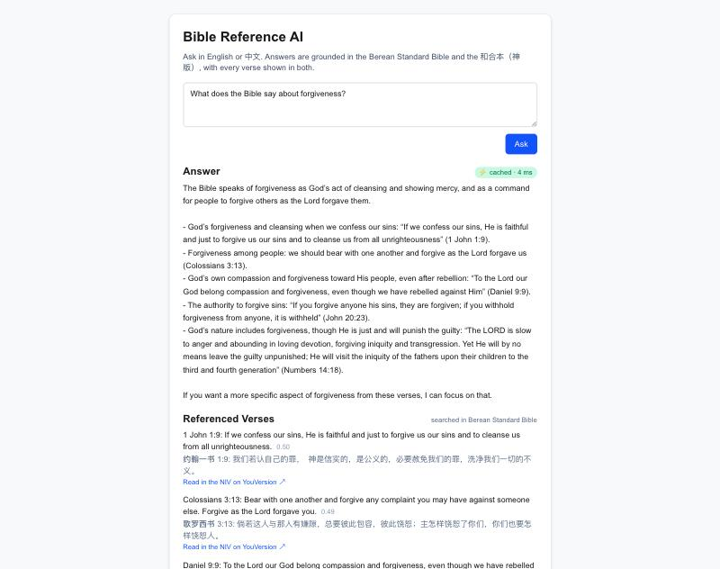

# Bible Reference AI

A retrieval-augmented scripture assistant. Ask a question in English or 中文 and get an answer grounded in the Berean Standard Bible or the 和合本（神版）, with the exact verses it was drawn from returned alongside it — each shown in both languages.

**Stack:** Python 3.13 · FastAPI · LangChain 1.x · OpenAI (`text-embedding-3-small`, `gpt-5-nano`, `omni-moderation-latest`) · Pinecone · Redis · Next.js 16 · Ragas · uv · Docker · Kubernetes

## How it works

```
                 ┌──────────────────────── ingestion (one-off) ────────────────────────┐
                 │  Berean Standard Bible (en, 31,086 verses) + 和合本 神版 (zh, 31,021)  │
                 │      └─▶ scripts/load_and_embed.py   aligns both by verse id         │
                 │            batches of 100 ─▶ text-embedding-3-small (1536-d)        │
                 │            ─▶ Pinecone, one namespace per translation, cosine;       │
                 │               every vector carries both parallel texts               │
                 └──────────────────────────────────────────────────────────────────────┘

  browser ─▶ Next.js /api/query (server route, proxies to backend)
                 │
                 ▼
          FastAPI POST /api/query { question }
                 │
                 ├─ rate limit               Redis sliding window: 20/min per client IP, 60/min overall ── 429
                 ├─ L1  exact cache          Redis, keyed by the normalized question ── hit ─▶ respond (~ms)
                 │        │ miss
                 ├─ detect language          any Han character ⇒ zh ⇒ the 和合本 namespace; otherwise en ⇒ BSB
                 ├─ moderation ║ embed       two independent calls, run in parallel
                 │                           (embedding itself cached in Redis for 7d)
                 ├─ L2  semantic ║ retrieve  both need only the vector, run in parallel
                 │        │                  L2: nearest previously-answered question in a
                 │        │                      Pinecone namespace; cosine ≥ 0.85 ─▶ reuse its answer
                 │        │ miss             retrieve: top-k verses of that translation, kept only if cosine ≥ SCORE_THRESHOLD
                 ├─ generate                 gpt-5-nano (reasoning_effort=minimal), prompted to answer only from the
                 │                           retrieved verses, in the question's language, cite them, "not sure" otherwise
                 ├─ store                    answer ─▶ L1 (24h TTL); question vector ─▶ L2 (async, tagged with language)
                 └─ respond                  { answer, verses: [{ book, book_zh, chapter, verse, text, text_en, text_zh, score }],
                                               meta: { cache, language, translation, timings_ms, … } }   +  X-Cache header
```

Running on GKE (2026-10-01) — an English question answered from the Berean Standard Bible with the 和合本 alongside, and a Chinese one the other way round:

| | |
|---|---|
|  |  |

The retrieved verses are returned as structured data, not just quoted in prose, so the UI can render them as citations and the user can check every claim against the text. Verse ids (`John.3.16`) are the same in both translations, so each citation is shown in English and Chinese side by side, with a link to read it in a licensed edition (NIV, 新标点和合本) on YouVersion. Each verse carries its cosine similarity to the question, and every response says how it was served and where the time went.

## Caching

Two tiers in front of the RAG pipeline, both keyed by the **normalized** question (NFKC, case-folded, whitespace collapsed, trailing punctuation dropped — `"What is LOVE??"` and `"what is love"` are the same key):

| tier | store | what it saves | typical latency |
|---|---|---|---|
| L1 exact | Redis | moderation + embedding + Pinecone + LLM | a few ms |
| L2 semantic | Pinecone namespace (`semantic-cache-*`) + Redis | the LLM call — by far the slowest and most expensive one | embedding + one Pinecone query |
| embeddings | Redis | the embedding call, on any later miss for the same question | — |

Design points worth knowing:

- **Keys carry a config fingerprint.** Everything that changes an answer (chat model, embedding model, `TOP_K`, `SCORE_THRESHOLD`, prompt version) is hashed into the namespace (`app/config.py`). Change the prompt and the old answers are simply never read again; embeddings live outside that namespace, so they survive a prompt change.
- **Only real answers are cached.** Moderation refusals and "not enough context" responses go through every time; a transient retrieval hiccup never gets frozen into the cache.
- **Exact hits skip moderation** — the identical normalized string already passed it. Semantic hits do **not**: moderation is running in parallel with the embedding anyway, so the check is free.
- **Redis is optional.** If it is unreachable the cache reports misses behind a 30s circuit breaker (0.5s socket timeouts), the service keeps answering, and `/health` reports `"redis": "down"`.
- **The semantic threshold is calibrated, not guessed.** Across 16 paraphrase pairs (`scripts/benchmark_paraphrases.txt`) and the 496 pairs of different questions in the benchmark set, paraphrases score 0.71–0.97 (median 0.88) while the closest pair of *different* questions — "riches" vs "the poor" — scores 0.755. The default 0.85 reuses an answer for 9 of 16 paraphrases with zero false matches and a 0.1 margin; 0.82 would catch 14 of 16 with a thinner margin, and the original 0.95 caught 1. Lookups are filtered by language, so a Chinese paraphrase never receives an English answer.

Observability: `X-Cache: HIT-EXACT | HIT-SEMANTIC | MISS` and `X-Response-Time-Ms` on every response, `meta.timings_ms` broken down by stage, `GET /api/cache/stats` for hit counts and hit rate (kept in Redis, so they are cluster-wide across replicas), and `GET /health` for Redis reachability.

## Rate limiting

A public endpoint in front of a metered LLM API needs a ceiling. `POST /api/query` is limited per client IP (20/min) and globally (60/min — at gpt-5-nano prices that bounds a sustained attack to well under $1/hour, and an OpenAI project budget is the hard stop behind it) with a sliding-window counter in Redis: the previous minute's count is weighted by how much of the current minute remains, which removes the double burst a fixed window allows at each boundary, for one `INCR` + one `GET` per request. Over the limit the API answers 429 with `Retry-After`; every response carries `X-RateLimit-Limit` / `X-RateLimit-Remaining`. Quotas live outside the cache namespace, so a config change never resets them, and the limiter fails open if Redis is down. Behind a proxy the client address is read from `X-Forwarded-For` at a configurable position (`CLIENT_IP_XFF_INDEX`: `-1` for nginx, `-2` for Google's L7 load balancer, which appends `<client>, <lb-ip>`), so a client cannot spoof its way to a fresh quota.

## Ground truth and evaluation

The retriever is scored against a hand-labelled golden set (`scripts/golden_set.jsonl`: 32 questions in English and Chinese, each with the verses a reader would expect, e.g. *What is the greatest commandment?* → Matthew 22:37–39, Mark 12:30–31). Because verse ids are shared across translations, one label set scores both the English and the Chinese namespace. `scripts/eval_retrieval.py` embeds each question once and reports **hit@k** (a listed verse is in the top k), **MRR**, and, as lower bounds since the lists are partial, recall@k and the precision of everything above `SCORE_THRESHOLD`. It is deterministic, needs no LLM judge, and prints the misses with what was retrieved instead — that is the loop for tuning `TOP_K` / `SCORE_THRESHOLD` or fixing a label.

```bash
uv run python -m scripts.eval_retrieval --k 5 10
```

Each question carries two label sets: **canonical** (the famous verses a reader names from memory — strict) and **relevant** (canonical plus every on-topic verse found while reviewing the retriever's top-10 — what a reader would accept; built by looking at retriever output, so quote it with that caveat). Measured 2026-09-30 with `TOP_K=5`: hit@5 **56%** strict / **100%** curated, MRR 0.49 / 0.91. The gap is the retriever's real limitation: single-vector dense retrieval matches question-shaped verses to question-shaped queries ("Who do you say I am?" for *Who is Jesus?*) and short formulaic verses ("Grace and peace to you…" four times for *What is grace?*). Query rewriting or hybrid search is the obvious next step, and this eval is how it would be measured.

The same run calibrated the relevance gate: off-topic English questions score at most 0.38 against the index, on-topic ones 0.47 and up, and Chinese scores run about 0.05 higher, so `SCORE_THRESHOLD=0.40` / `SCORE_THRESHOLD_ZH=0.45` replaced the original 0.5 — which had been rejecting the best verses for "What does the Bible say about love?".

Answer quality is scored separately with reference-free Ragas metrics (next section), because the "right answer" to a scripture question is whatever the retrieved verses support, not a fixed string.

## Benchmark

With the backend running and Redis reachable:

```bash
cd backend
python -m scripts.benchmark_cache --flush --mixed 300 --concurrency 4
```

Phases: **cold** (every question once → misses), **warm-exact** (same questions → L1), **warm-semantic** (paraphrases → L2 or miss), and **mixed** (Zipf-sampled repeat traffic from an empty cache, the closest thing to real usage). For each it reports client-side p50/p95, the server's per-stage means, and how many upstream OpenAI calls were avoided relative to running uncached. Results go to `backend/eval_results/cache_benchmark.json`.

### Results

Measured 2026-09-30 on a laptop — backend and Redis (Docker) local, Pinecone in AWS us-east-1, gpt-5-nano, concurrency 4, cache flushed before the cold and mixed phases:

| phase | requests | hit rate | p50 | p95 | upstream OpenAI calls avoided |
|---|---|---|---|---|---|
| cold — 32 new questions | 32 | 0% | 2,949 ms | 4,322 ms | 0% |
| warm — the same 32 again | 32 | 100% (exact) | **6 ms** | 10 ms | 100% |
| paraphrases — 16 rewordings | 16 | 56% (semantic) | 342 ms | 2,420 ms | 19% |
| mixed — 300 Zipf-sampled requests over 46 distinct questions | 300 | 84% (241 exact + 12 semantic) | 5 ms | 2,657 ms | **82%** |

Where a cold request spends its time: generation ≈ 2.2 s, moderation ≈ 0.2 s, embedding ≈ 0.2 s, Pinecone retrieval ≈ 0.05 s, semantic lookup ≈ 0.04 s — moderation and the semantic lookup overlap with the other stages. A semantic hit pays the embedding plus one Pinecone query and skips the LLM, hence ~340 ms; an exact hit is a single Redis read.

The 82% is what repeat traffic looks like when a few questions dominate. It is the number behind any "fewer API calls" claim, and it scales with how repetitive real traffic is — which is why the benchmark reports the distinct-question count next to it.

The same benchmark against the **GKE Autopilot deployment** (us-east1; backend, Redis and the L7 load balancer in the cluster; run through `kubectl port-forward`, which pins it to one backend pod — see [k8s/README.md](k8s/README.md)):

| phase | requests | hit rate | client p50 | server p50 | p95 | upstream OpenAI calls avoided |
|---|---|---|---|---|---|---|
| cold | 32 | 0% | 2,113 ms | — | 4,010 ms | 0% |
| warm — exact | 32 | 100% | 138 ms ¹ | **2 ms** | 257 ms | 100% |
| paraphrases — semantic | 16 | 56% | 614 ms | 468 ms | 2,434 ms | 19% |
| mixed — 300 requests, 46 distinct | 300 | 85% | 136 ms ¹ | 2 ms | 2,118 ms | **83%** |

¹ Client-side latency here includes ~130 ms of `kubectl port-forward` tunnelling through the Kubernetes API server; the server-side figure is what a browser behind the load balancer sees. Cold requests are faster from the cluster than from a laptop (2.1 s vs 2.9 s p50) because us-east1 sits next to both OpenAI and the Pinecone index. Results: `backend/eval_results/cache_benchmark_gke.json`.

## Evaluation

`scripts/eval_with_ragas.py` runs a question set through the pipeline and scores each answer with [Ragas](https://docs.ragas.io) on **faithfulness** (is the answer supported by the retrieved verses?) and **answer relevancy** (does it address the question?). Results are written to `backend/eval_results/ragas_eval_results.csv` and were reviewed by hand alongside the automated scores. Records served from cache are skipped, so a repeated question is scored once.

### Choosing the chat model

`scripts/compare_models.py` retrieves context once per question and has every candidate model answer from the same verses, reporting p50/p95 latency, output tokens, cost per 1k queries (prices from the OpenAI pricing page) and how often the model declines. It writes one JSONL per model in the query-log format so quality can be scored the same way:

```bash
uv run python -m scripts.compare_models --models gpt-4o-mini gpt-6-luna gpt-5-nano --limit 20
uv run --group eval python -m scripts.eval_with_ragas --log eval_results/model_compare/gpt-6-luna.jsonl \
    --out eval_results/model_compare/gpt-6-luna_ragas.csv
```

Run on 2026-09-30 against the 32-question golden set, judged with Ragas (faithfulness = is every claim supported by the retrieved verses; answer relevancy = does it answer the question, with hedged non-answers scored 0):

| model | faithfulness | answer relevancy | p50 latency | $ / 1k queries | "not sure" rate |
|---|---|---|---|---|---|
| **gpt-5-nano** (effort=minimal) | **0.904** | **0.882** | 1.84 s | **$0.076** | 0% |
| gpt-4o-mini | 0.895 | 0.863 | 1.49 s | $0.118 | 3% |
| gpt-6-luna (effort=none) ¹ | 0.875 | 0.706 | 2.38 s | $0.075 | 20% |
| gpt-5.4-nano (effort=none) ¹ | 0.903 | 0.411 | 1.70 s | $0.256 | 20% |

¹ 20-question round; the two finalists were re-run on all 32.

The newest, cheapest model (gpt-6-luna) was the obvious pick on the pricing page and the wrong one here: it is the slowest and hedges a fifth of its answers, and gpt-5.4-nano hedges even more at 3× the price. gpt-5-nano and gpt-4o-mini tie on quality within noise; nano is 35% cheaper, never refuses and is the current family, so it is the default — at the cost of ~0.35 s of latency that the cache removes for repeat questions. Grounded QA over five short verses gains nothing from reasoning tokens, so each family runs at its lowest effort. Switching is an env change (`CHAT_MODEL`), and the cache namespace rolls over with it.

## Repository layout

```
backend/
  app/main.py                    FastAPI app: GET /health, POST /api/query, GET /api/cache/stats, CORS
  app/config.py                  env-driven settings + the config fingerprint that namespaces the cache
  app/services/query_pipeline.py orchestration: caches, parallel moderation/retrieval, timings
  app/services/rag_service.py    RAGService: embed / retrieve (per-translation namespace, threshold on raw cosine) / generate
  app/verses.py                  the two translations: parse ebible.org verse-per-line files, align by verse id
  app/books.py                   66 books: USFM code ↔ English name ↔ 和合本 name
  app/language.py                question language detection (en / zh)
  app/services/cache.py          RedisCache (L1 + embeddings + counters), SemanticCache (L2)
  app/services/openai_client.py  embeddings, chat completion, moderation helpers
  app/services/pinecone_client.py index bootstrap (1536-d, cosine) and access
  scripts/init_pinecone.py       create the index
  scripts/load_and_embed.py      embed both translations into their namespaces (--dry-run to preview)
  scripts/golden_set.jsonl       32 questions with the verses the retriever should surface (ground truth)
  scripts/eval_retrieval.py      hit@k / MRR / recall against the golden set, no LLM judge
  scripts/eval_with_ragas.py     Ragas evaluation run (--log / --out to score any answer file)
  scripts/benchmark_cache.py     cold / warm / semantic / mixed-traffic latency and hit-rate benchmark
  scripts/compare_models.py      chat-model comparison on identical retrieved context
  tests/                         pytest suite (fakeredis + in-memory RAG fakes; no network)
  data/bsb/, data/cuv/           the two public-domain translations + provenance (see Data below)
  eval_results/                  Ragas, benchmark and model-comparison output
  pyproject.toml, uv.lock        runtime deps + `dev` and `eval` groups, locked
  Dockerfile, .dockerignore
frontend/
  app/page.tsx                   chat UI (shows cache status, timings and per-verse similarity)
  app/api/query/route.ts         server-side proxy to the backend (backend URL never reaches the client)
  Dockerfile
k8s/
  base/                          namespace, configmap, backend (2 replicas), frontend, redis
  overlays/gke/                  Artifact Registry images, LoadBalancer, deploy.sh (Cloud Build + rollout)
  overlays/kind/                 local images + nginx ingress
  README.md                      GKE runbook
kind-config.yaml                 local kind cluster for testing the manifests
```

## Running locally

**Redis** (optional, but the cache and benchmark need it)

```bash
docker run --rm -d -p 6379:6379 --name bible-redis redis:7-alpine
```

or `brew install redis && brew services start redis`.

**Backend** (needs [uv](https://docs.astral.sh/uv/) and Python 3.12+; `uv sync` creates `.venv` from the lockfile)

```bash
cd backend
uv sync                          # runtime + dev deps; add --group eval for the Ragas scripts
cp .env.example .env             # fill in OPENAI_API_KEY, PINECONE_API_KEY, PINECONE_INDEX_NAME, PINECONE_ENVIRONMENT
uv run python -m scripts.init_pinecone
uv run python -m scripts.load_and_embed --dry-run   # parse + align + cost estimate, no API calls
uv run python -m scripts.load_and_embed             # one-off: ~62k verses, ~10 min, ≈ $0.05
uv run uvicorn app.main:app --reload --port 8000
```

**Tests**

```bash
cd backend
uv run pytest
```

**Frontend**

```bash
cd frontend
npm install
BACKEND_URL=http://127.0.0.1:8000 npm run dev
```

**Kubernetes**

Manifests are a kustomize base plus two overlays, `k8s/overlays/gke` (Autopilot, Artifact Registry images tagged by git SHA, LoadBalancer) and `k8s/overlays/kind` (local). The GKE runbook — one-time project setup, `deploy.sh`, verification, teardown and costs — is in [k8s/README.md](k8s/README.md).

```bash
cp k8s/secret.example.yaml k8s/secret.yaml   # fill in real values; secret.yaml is gitignored
k8s/overlays/gke/deploy.sh                    # Cloud Build both images, apply, wait, print the public URL
```

Tunables (models, `TOP_K`, `SCORE_THRESHOLD`, cache TTLs, semantic threshold, Redis host, Pinecone index/env, backend URL) live in `k8s/base/configmap.yaml`; the backend reads Redis from `REDIS_URL` or the `REDIS_HOST`/`REDIS_PORT` pair.

## Data

Two public-domain translations, vendored as ebible.org verse-per-line text under `backend/data/` with the licence pages each archive ships with (details and verse-count differences in [backend/data/README.md](backend/data/README.md)):

- **English — Berean Standard Bible** (`bsb`): placed in the public domain by its publisher on 2023-04-30.
- **中文 — 和合本（神版）** (`cuv`): the 1919 Union Version text, public domain, rendering the divine name as 神.

Licensed translations (NIV, 新标点和合本, …) are deliberately not stored: their publishers allow at most a few hundred quoted verses and no offline or AI use without a written licence, and the YouVersion Platform's terms permit AI only for verbatim retrieval-and-display, not for a question-answering chat. The UI links each cited verse to YouVersion instead, which needs no licence.

## Notes

- Secrets are read from environment variables only. `backend/.env` and `k8s/secret.yaml` are gitignored; the `.example` files show the expected keys.
- Switching models is an env change: `CHAT_MODEL=gpt-6.1-sol`, optionally `CHAT_REASONING_EFFORT=low`. Left empty, the effort defaults to each family's cheapest setting, and reasoning-family models (gpt-5 / gpt-6 / o-series) are never sent a `temperature`. Any such change rolls the cache namespace over automatically.
- Dependencies are locked with uv. The runtime image installs only `pyproject.toml`'s `dependencies`; `dev` (pytest, fakeredis) and `eval` (ragas, pandas, datasets) are separate groups. ragas 0.4.x pins the openai SDK below 2.x, so the `eval` group stays on ragas 0.3.
- The prompt instructs the model to decline rather than speculate when retrieval is weak; `SCORE_THRESHOLD` / `SCORE_THRESHOLD_ZH` (raw Pinecone cosine similarity, per language) decide "weak". They are applied in `RAGService.retrieve`, not through LangChain's retriever wrapper, which silently ignores the threshold for Pinecone.
- Fallback messages (moderation refusal, no verses found) are bilingual English / 中文 and live in `app/services/messages.py`.
